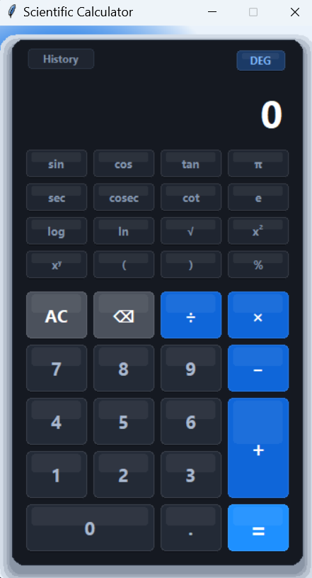
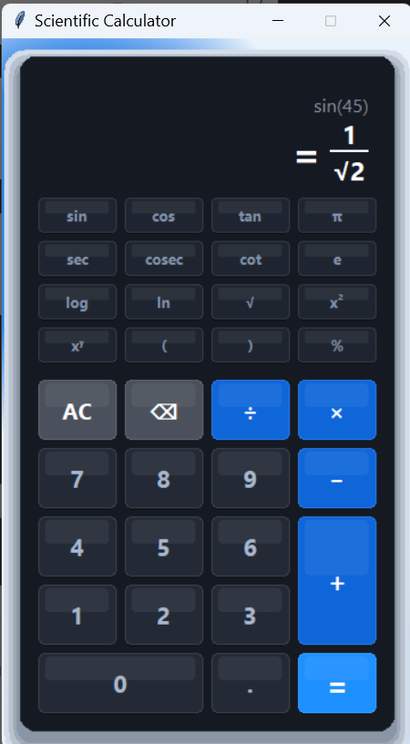
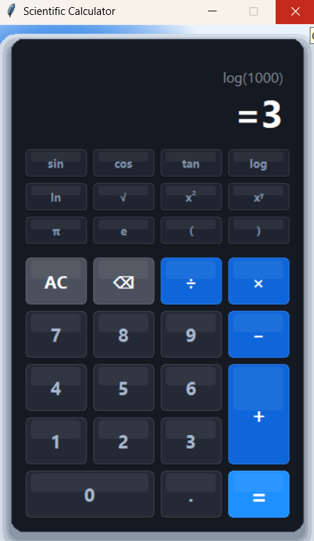
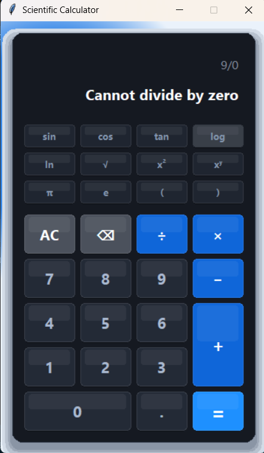
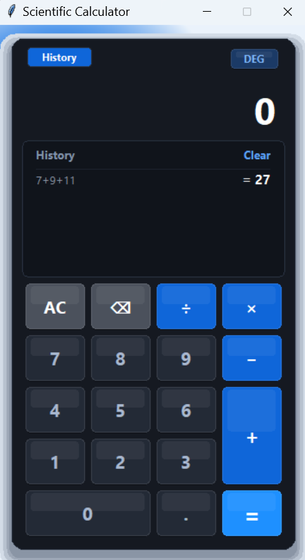
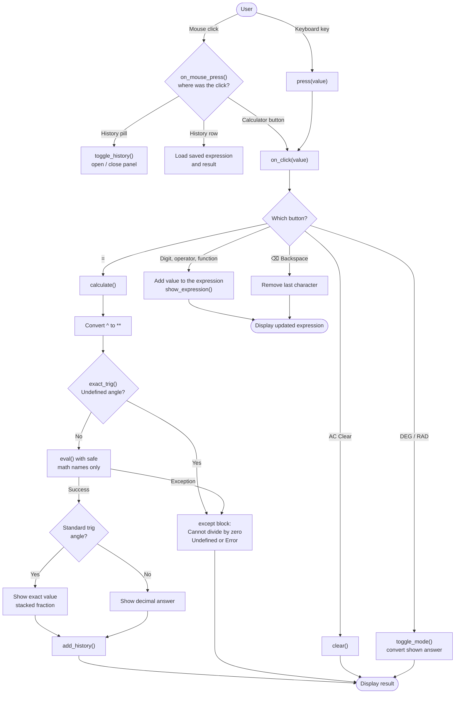

# 🧮 Scientific Calculator (Python Tkinter)
 
A desktop scientific calculator built with Python and Tkinter. It supports basic arithmetic, scientific functions, **exact trigonometric values**, a **DEG / RAD mode** and a scrollable **calculation history**, all in a modern dark glass-style interface.
 
> **Course Assignment** · Problem 1 · Marks: 20 · Group of 3
 
---
 
## 📸 Screenshots
 

 
| Trigonometric | Logarithm | Error Handling |
|---|---|---|
|  |  |  |
 
| History Panel | RAD Mode |
|---|---|
|  |  |
 
---
 
## 📋 Minimum Requirements (given in the assignment)
 
| # | Requirement | Status | How this project meets it |
|---|---|---|---|
| 1 | Buttons for numbers, basic arithmetic operators and decimal values | ✅ | Digits `0-9`, `.`, and `+  −  ×  ÷  %`, drawn by `create_buttons()` |
| 2 | Square root, square, power and trigonometric operations | ✅ | `√`, `x²`, `xʸ`, and `sin`, `cos`, `tan` (plus `sec`, `cosec`, `cot`) |
| 3 | Display the entered expression and the calculated result | ✅ | Small expression line on top, large result line below (`show_expression()`, `show_result()`) |
| 4 | Clear and Backspace buttons | ✅ | `AC` calls `clear()`, `⌫` calls `backspace()` |
| 5 | Handle invalid operations such as division by zero | ✅ | `try/except` in `calculate()` shows `Cannot divide by zero`, `Error` or `Undefined` |
 
---
 
## ✨ Features
 
### Core features
- Number buttons (0-9) and decimal point
- Basic operators: `+`  `−`  `×`  `÷`  `%`, plus brackets `( )`
- Scientific functions: square root (`√`), square (`x²`), power (`xʸ`), `log`, `ln`, `π`, `e`
- Trigonometric functions: `sin`, `cos`, `tan`, `sec`, `cosec`, `cot`
- Two-line display: the expression you typed and the calculated result
- **AC** (Clear) and **⌫** (Backspace) buttons
- Thousand separators in answers (`12454` is shown as `12,454`)
- Keyboard support: digits and operators, `Enter` = calculate, `Backspace` = delete, `Esc` = clear
- Button hover effect and a press animation (squish plus water ripple)
- Error handling for division by zero, invalid expressions, math errors and undefined values
### ⭐ Exact trigonometric values
Standard angles show exact answers like a trigonometric table, drawn as a **stacked fraction**:
 
| Input | Output |
|---|---|
| `sin(30)` | `1/2` |
| `cos(45)` | `1/√2` |
| `tan(60)` | `√3` |
| `sin(270)` | `−1` |
| `tan(90)` | `Undefined` |
 
Other angles (for example `sin(17)`) give a normal decimal answer.
 
### ⭐ DEG / RAD mode
- The **DEG / RAD** pill at the top-right of the card switches the angle mode. The default is **DEG**.
- In **RAD** mode, enter angles in radians. For example `sin(pi/6)` gives `1/2` and `cos(pi)` gives `−1`.
- **Answer conversion:** if a calculated answer is on the screen and you press the pill, the answer is converted too:
  | Step | Screen |
  |---|---|
  | Type `90`, press `=` | `=90` |
  | Press the pill (DEG to RAD) | `=1.5707963268` |
  | Press the pill again (RAD to DEG) | `=90` |
### ⭐ Calculation history
- The **History** pill at the top-left of the card opens a panel with your previous calculations, **newest first**.
- Up to **30** calculations are remembered. **5 rows** are visible at a time, and you can scroll with the **mouse wheel**.
- **Click a row** to load that expression and its answer back onto the screen. The expression is editable again.
- **Clear** (top-right of the panel) empties the list.
- Failed calculations (errors) are not saved, and exact repeats are saved only once.
- Click the History pill again to close the panel.
---
 
## 🔄 Workflow Diagram
 

 
**The same workflow in words**
1. The user clicks a button with the mouse or presses a key on the keyboard.
2. The click position (or key) is matched to a button value, and `on_click(value)` is called.
3. Digits, operators and functions are added to the expression string and shown on the display.
4. When `=` is pressed, `calculate()` converts `^` to `**`, checks for an exact trig value, and evaluates the expression with `eval()` using only safe math names.
5. If the calculation works, the answer is shown and saved in the history.
6. If it fails, the matching `except` block shows a friendly message instead of crashing.
---
 
## 📚 Concepts Demonstrated
 
| Concept (from the assignment) | Where it is used in this project |
|---|---|
| **Tkinter widgets** | `Tk` window and a `Canvas` that draws the card, display text, buttons and history panel (`PhotoImage` paints the background) |
| **Grid layout** | Buttons are placed in rows and columns, using computed positions (`col_x()` and `row_y()` in `create_buttons()`). The `+` button spans two rows and `0` spans two columns |
| **Event handling** | Mouse press, mouse movement (hover), mouse wheel (history scroll) and keyboard bindings, all set in `bind_events()` |
| **Functions** | `calculate()`, `on_click()`, `exact_trig()`, `exact_value()`, `blend()`, `pretty()` and the trig functions |
| **Mathematical operations** | The `math` module: `sqrt`, `log10`, `log`, `sin`, `cos`, `tan`, `radians`, `degrees`, plus power and modulo |
| **Exception handling** | `try/except` for `ZeroDivisionError`, `ValueError`, `SyntaxError`, `TypeError`, `NameError`, `OverflowError` and a custom `UndefinedError` |
 
**Additional concepts**
- Classes and objects (`Calculator`, `GlassButton`)
- A list used as the calculation history
- Simple animation using `after()`
- Regular expressions (`re`) to detect a single trig call
---
 
## 🎤 Viva Quick Notes
 
**How are button clicks processed?**
Every mouse press goes to `on_mouse_press()`. It finds the button under the mouse and calls `on_click(value)`. The value is added to the `expression` string and shown on the display. Keyboard keys go through `press(value)` into the same `on_click()`.
 
**How are expressions evaluated?**
When `=` is pressed, `calculate()` converts `^` to `**` and runs the text through `eval()`. Python's built-ins are switched off (`__builtins__` is empty), so only the names in `SAFE_NAMES` (`sin`, `cos`, `sqrt`, `log`, `pi` ...) can be used. Trig functions convert degrees to radians first.
 
**How are errors handled?**
A `try/except` block catches `ZeroDivisionError`, `ValueError` (for example `sqrt(-1)`), `SyntaxError`, `TypeError`, `NameError`, `OverflowError` and the custom `UndefinedError` (for example `tan(90)`). The user sees a friendly message and the app keeps running.
 
---
 
## 🛠️ Requirements
 
- Python 3.8 or higher
- Tkinter (comes pre-installed with Python on Windows and macOS)
No extra libraries need to be installed.
 
> On some Linux systems, install Tkinter with: `sudo apt install python3-tk`
 
---
 
## 🚀 How to Run
 
1. Clone the repository:
```bash
git clone https://github.com/nihaltiwari01/scientific-calculator.git
```
2. Go into the folder:
```bash
cd scientific-calculator
```
3. Run the program:
```bash
python scientific_calculator.py
```
   (Use `python3` instead of `python` on macOS/Linux if needed.)
 
---
 
## 📖 How to Use
 
| To do this | Do this |
|---|---|
| Add numbers | Click digit buttons or type on the keyboard |
| Use a function | Click `sin`, `√`, etc., then type the value and close the bracket, e.g. `sqrt(16)` |
| Square a number | Type the number, then click `x²` |
| Raise to a power | Type the base, click `xʸ`, then type the exponent |
| Get the answer | Click `=` or press `Enter` |
| Delete last character | Click `⌫` |
| Reset everything | Click `AC` |
| Switch degrees / radians | Click the `DEG` / `RAD` pill (top-right) |
| See past calculations | Click the `History` pill (top-left) |
| Reuse a past calculation | Open History and click its row |
| Scroll the history | Use the mouse wheel over the panel |
 
**Examples**
 
| Input | Output |
|---|---|
| `2^3` | `8` |
| `sqrt(16)` | `4` |
| `6000/2+3227*2` | `9,454` |
| `sin(30)` | `1/2` |
| `5/0` | `Cannot divide by zero` |
| `sqrt(-1)` | `Error` |
| `tan(90)` | `Undefined` |
 
---
 
## 📁 Project Structure
 
```
scientific-calculator/
├── scientific_calculator.py   # Main source code
├── home.png                   # Home screen screenshot
├── sin.png                    # Trigonometric example
├── log.png                    # Logarithm example
├── error.png                  # Error handling example
├── history.png                # History panel screenshot
├── rad.png                    # RAD mode screenshot
└── README.md                  # Project documentation
```
 
---
 
## 👥 Team Members
 
| Name | Roll No. |
|---|---|
| Nihal Tiwari | C25CS007 |
| Mudit Tejra | C25CS009 |
| Pawan Kumar Nayak | C25CS011 |
 
**Institute:** National Institute of Technology Meghalaya  
**Program:** MCA, 3rd Semester
 
---
 
## 📄 License
 
This project was created for academic purposes.
 